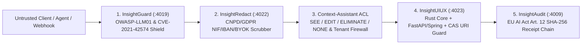

# 🔐 Security, Privacy & PT/EU Statutory Compliance Dossier (`InsightUIUX`)

> **Service**: `InsightUIUX` (`:4023` `/api/uiux`)
> **Statutory Baseline**: `RULE-11` (Portugal & European Union AI, Privacy, Accessibility, Cybersecurity & Fiscal Verification)

---

## 1. Threat Model & Defense-in-Depth Architecture

---

## 2. Key Security Controls Implemented in `InsightUIUX`

1. **Trojan-Source & Steganographic Unicode Stripping (`CVE-2021-42574`)**:
   - Strips zero-width characters (`U+200B`–`U+200F`, `U+FEFF`, `U+E0000`–`U+E007F`) and bidirectional overrides (`U+202A`–`U+202E`, `U+2066`–`U+2069`) in both `rust_core/` and `insight_core_io`.
2. **Database vs. Object Storage Separation (`CAS Vault`)**:
   - `assert_no_binary_blob_in_db_row()` blocks raw byte arrays and `data:*;base64,...` strings (`> 256` chars) from polluting transactional tables, enforcing `cas://sha256/<digest>` pointers.
3. **Path Traversal (`CWE-22`) & Command Injection (`CWE-78`/`CWE-88`) Guards**:
   - Rejects `..`, null bytes (`\x00`), leading-dash Git flag injection (`-`), and `shell=True` subprocess invocations.
4. **Granular Project & Agent Authorization (`CWE-285` / `CWE-639`)**:
   - Managed by `ProjectAndAgentAuthorizationService`: team members with `ProjectAccessLevel.NONE` have zero visibility or mutation rights, and each specialist agent has a single `1:1` responsible human owner (EU AI Act Art. 14).
5. **Cross-Tenant Firewall (`RBAC-06`)**:
   - Strict logical isolation between `SETMIDDLE` (`setmiddle-dev-team`) and `INSIGHTCV_ECOSYSTEM` (`insightcv-dev-team`).
